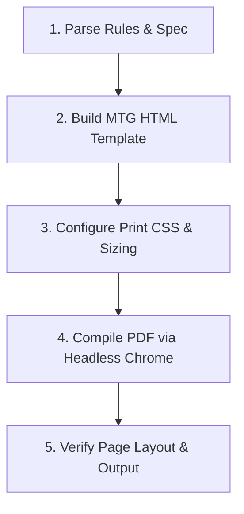

# MTG Card Deck & PDF Generation Skill

This skill documents the step-by-step procedure for creating MTG-sized game cards from rules specifications, building responsive HTML card templates, configuring print CSS stylesheets, and compiling print-ready PDF card sheets.

---

## Workflow Overview



---

## Step 1: Parse Game Rules & Resource Schemas

1. Extract all card specs from the rulebook (`RULES.md`).
2. Map resource types to standardized single-letter shorthand notations and color themes:
   - **G** = Goods (`color: #4ade80`, glowing green)
   - **M** = Minerals (`color: #fc8484`, glowing red/pink)
   - **T** = Tech (`color: hsl(65, 93%, 60%)`, glowing lime/cyan)
3. Calculate rewards scaling based on cargo complexity:
   - **2 Units of Cargo** ➔ 20 Credits / VP
   - **3 Units of Cargo** ➔ 30 Credits / VP
   - **4 Units of Cargo** ➔ 40 Credits / VP
4. Group cards by location deck (e.g., Planet Decks vs Space Station Decks).

---

## Step 2: HTML & CSS MTG Card Anatomy

Strict Magic: The Gathering (MTG) card dimensions must be enforced to ensure physical compatibility with standard card sleeves and deck boxes (`2.5" × 3.5"` / `63.5mm × 88.9mm`).

### Card CSS Requirements

```css
/* Standard MTG Card Sizing */
.card {
    width: 2.5in;
    height: 3.5in;
    min-width: 2.5in;
    min-height: 3.5in;
    max-width: 2.5in;
    max-height: 3.5in;
    background: #ffffff;
    border: 4px solid #0a0a0a;
    border-radius: 14px;
    box-shadow: 0 8px 20px rgba(0, 0, 0, 0.7);
    display: flex;
    flex-direction: column;
    box-sizing: border-box;
    overflow: hidden;
    position: relative;
    flex-shrink: 0;
}

/* Card Header */
.header {
    background: #0f172a;
    color: #f8fafc;
    text-align: center;
    font-size: 13px;
    font-weight: bold;
    letter-spacing: 2px;
    padding: 10px 0;
    text-transform: uppercase;
    border-bottom: 2px solid #1e293b;
}

/* Middle Canvas & 2x2 Resource Overlay Grid */
.middle-canvas {
    flex: 1;
    display: flex;
    align-items: center;
    justify-content: center;
    background: #0b132b;
    position: relative;
    overflow: hidden;
}

.resource-overlay {
    position: absolute;
    top: 0; left: 0; right: 0; bottom: 0;
    z-index: 2;
    display: grid;
    grid-template-columns: 1fr 1fr;
    grid-template-rows: 1fr 1fr;
    gap: 8px;
    padding: 12px;
    box-sizing: border-box;
}

.resource-box {
    background: rgba(40, 40, 40, 0.65);
    border: 1px solid rgba(255, 255, 255, 0.25);
    border-radius: 6px;
    display: flex;
    align-items: center;
    justify-content: center;
}

/* Footer & Points Circle */
.footer {
    height: 60px;
    display: flex;
    justify-content: center;
    align-items: center;
    background: radial-gradient(circle at center, #0c1524 0%, #060b12 100%);
    border-top: 2px solid #1a2942;
}

.points-circle {
    width: 40px;
    height: 40px;
    border: 3px solid #00f2fe;
    border-radius: 50%;
    background: #020617;
    display: flex;
    align-items: center;
    justify-content: center;
    color: #00f2fe;
    font-size: 16px;
    font-weight: bold;
}
```

### Card HTML Structure Example

```html
<div class="card">
    <div class="header">Riter</div>
    <div class="middle-canvas">
        
        <div class="resource-overlay">
            <div class="resource-box"><span class="resource-label res-g">G</span></div>
            <div class="resource-box"><span class="resource-label res-m">M</span></div>
            <div class="resource-box"></div>
            <div class="resource-box"></div>
        </div>
    </div>
    <div class="footer">
        <div class="points-circle">20</div>
    </div>
</div>
```

---

## Step 3: Print Optimization & Page Setup

Add print styles for clean PDF compilation. Set the page background to white to save printer ink, force exact color printing, and prevent cards from breaking across page boundaries.

```css
@page {
    size: letter portrait;
    margin: 0.3in;
}

@media print {
    body {
        background-color: #ffffff !important;
        color: #000000 !important;
        padding: 0 !important;
        gap: 15px !important;
        -webkit-print-color-adjust: exact !important;
        print-color-adjust: exact !important;
    }

    /* Hide non-card UI controls */
    .reward-info, h1, .subtitle {
        display: none !important;
    }

    .row-title {
        color: #1e293b !important;
        border-bottom-color: #cbd5e1 !important;
        margin-top: 10px !important;
        page-break-after: avoid !important;
    }

    .card-row {
        max-width: none !important;
        gap: 0.1in !important;
        justify-content: flex-start !important;
    }

    .card {
        box-shadow: none !important;
        page-break-inside: avoid !important;
        break-inside: avoid !important;
        -webkit-print-color-adjust: exact !important;
        print-color-adjust: exact !important;
    }
}
```

---

## Step 4: PDF Compilation via Headless Chrome

Run Google Chrome in headless mode to generate the print-ready PDF:

```bash
"/Applications/Google Chrome.app/Contents/MacOS/Google Chrome" \
  --headless=new \
  --print-to-pdf="/path/to/output.pdf" \
  --no-pdf-header-footer \
  "file:///path/to/cards.html"
```

### Verification Checklist

- [ ] Open generated PDF or verify page size (`mdls output.pdf` showing `PageWidth = 612`, `PageHeight = 792`).
- [ ] Verify background is white for ink efficiency.
- [ ] Confirm cards render in a 3×3 grid at 100% scale (`2.5" × 3.5"` per card).
- [ ] Check that card background graphics, artwork, and glowing resource badges (`G`, `M`, `T`) are preserved.
